::: {.content-hidden when-format="revealjs"}
::: callout-note
## Reproducibility
Every figure in this paper is produced by one of two executed notebooks:
[`missing_data_analysis.ipynb`](notebook-missing-data.html) (Part I) and
[`rural_severity_model.ipynb`](notebook-rural-model.html) (Part II). The script
`project-site/scripts/export_assets.py` copies their figures into `project-site/assets/`. Key numbers
quoted in the text are kept in `_variables.yml`.
:::
:::

# Introduction

::: {.content-hidden when-format="revealjs"}
Crash databases are the main evidence base for road-safety policy, and they are rarely complete.
Fields go unrecorded, reports are filled in partially, and records are joined across tables in ways
that duplicate them. How an analyst handles these problems can change the answer to the question
that matters most: **what makes a crash deadly?**

This paper addresses two questions with PennDOT crash data [@penndot2026]:

1. **Missing data (Part I).** When predictors are missing, how do mean imputation, median imputation
   and complete-case removal change the data and a logistic regression fitted to it? Does the answer
   depend on whether values are missing at random (MAR) or not at random (MNAR)?
2. **Rural crash severity (Part II).** Using a first-principles approach combined with a simple
   filter, which ten factors best predict crashes in which someone is killed or seriously injured,
   and which of them contribute most on **rural roads**?

The outcome throughout is `FATAL_OR_SUSP_SERIOUS_INJ`: the crash had at least one person killed or
with a suspected serious injury. It is rare, about 5% of crashes, which shapes every modeling choice
below.
:::

::: {.content-visible when-format="revealjs"}
## Two questions

- Crash databases are incomplete and messy. How we handle that **changes the answer** to
  "what makes a crash deadly?"
- **Part I: missing data.** On the same  crashes, missing at random (**MAR**) vs.
  not at random (**MNAR**): how do *mean*, *median* and *complete-case* treatments bias a logistic regression?
- **Part II: rural severity.** With first principles + a simple filter, which **ten factors** best
  predict fatal / serious-injury crashes, and which matter most on **rural roads**?
- Outcome: `FATAL_OR_SUSP_SERIOUS_INJ`, rare (≈ 5% of crashes).

*Data: PennDOT crash records and data dictionary.*
:::

# Data

::: {.content-hidden when-format="revealjs"}
Three extracts are used, all row-aligned to the same crashes:

| File | Rows | Columns | Use |
|---|---|---|---|
| `MAR_ex1.xls` | 1,000 | 6 | Part I: predictors missing at random |
| `MNAR_ex1.xls` | 1,000 | 6 | Part I: predictors missing not at random |
| `features.xls` | 1,030 | 80 | Part I reference; Part II modeling |

: Data extracts {#tbl-files}

The six Part I variables are `SPEEDING`, `WET_ROAD`, `YOUNG_DRIVER` (0/1 flags), `HOUR_OF_DAY` (0–23),
`PERSON_COUNT`, and the outcome. `features.xls` adds 74 more crash, flag and roadway fields, documented
in the PennDOT data dictionary [@penndot2026].

## Data-quality findings

* **Inconsistent names.** The MAR file calls the hour column `HOUR` (MNAR: `HOUR_OF_DAY`), and the
  MNAR file's worksheet is named `MCAR_ex1`. Both are harmonized on load.
* **Spreadsheet debris.** Rows 1000–1029 of `features.xls` have no outcome and at most two filled cells. They are removed.
* **Duplicated crashes.** `LANE_COUNT` and `SPEED_LIMIT` come from PennDOT's ROADWAY table, which holds
  one row per road involved. When it is joined to the crash data, a crash on several roads appears
  several times. The 1,000 rows are only ** distinct crashes** (224 crashes
  appear 2–5 times; @sec-dedup). This matters for any model evaluated by cross-validation.
* **Undocumented codes.** `URBAN_RURAL = 4` (421 crashes) is not defined in the dictionary (only 1–3
  are), and `URBAN_AREA` is not documented at all. The `RURAL` flag, which equals `URBAN_RURAL = 1`
  exactly, is used instead.
* **Outliers.** `PERSON_COUNT = 48` is a genuine school-bus crash and is kept. `PERSON_COUNT = 0` is
  implausible for a reportable crash and is flagged. `HOUR_OF_DAY` and `SPEED_LIMIT` contain no
  out-of-range values.

{#fig-outliers}
:::

::: {.content-visible when-format="revealjs"}
## Data and data quality

:::: columns
::: {.column width="48%"}
- `MAR_ex1.xls`, `MNAR_ex1.xls`: the **same 1,000 crashes**, 6 columns, different gaps.
- `features.xls`: 80 columns of crash, flag and roadway fields.
- **The 1,000 rows are only  crashes.** The ROADWAY join repeats a crash once per road.
- `URBAN_RURAL = 4` is undefined. `PERSON_COUNT = 48` is a real school-bus crash; `= 0` is implausible.
:::
::: {.column width="52%"}
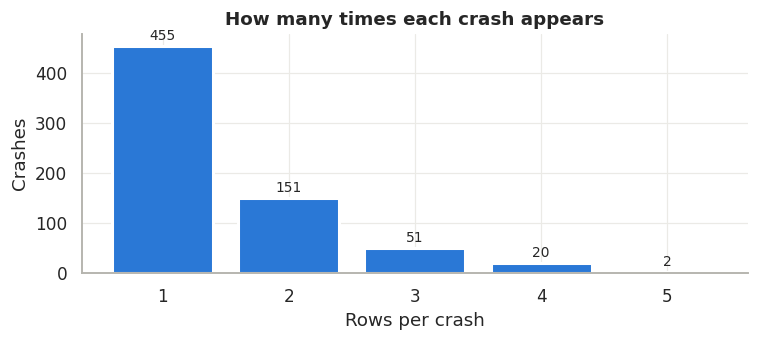
:::
::::
:::

# Part I: Missing-data treatments

::: {.content-hidden when-format="revealjs"}
## Missingness mechanisms

Let $R$ indicate which values are observed, and split the data into observed and missing parts,
$Y = (Y_{\text{obs}}, Y_{\text{mis}})$. Following @rubin1976 and @littlerubin2019:

$$
\begin{aligned}
\text{MCAR:}\quad & P(R \mid Y_{\text{obs}}, Y_{\text{mis}}) = P(R) \\
\text{MAR:}\quad  & P(R \mid Y_{\text{obs}}, Y_{\text{mis}}) = P(R \mid Y_{\text{obs}}) \\
\text{MNAR:}\quad & P(R \mid Y_{\text{obs}}, Y_{\text{mis}}) \text{ depends on } Y_{\text{mis}}
\end{aligned}
$$

Under MAR, missingness may depend on variables we *can* see (including the outcome) but not on the
hidden value itself. MNAR cannot be detected from observed data alone, because the evidence is
exactly what is missing. We can test it here only because the hidden values can be recovered
(@sec-reference).

@tbl-missing summarizes the gaps. Only `WET_ROAD`, `YOUNG_DRIVER` and `PERSON_COUNT` are affected,
and `PERSON_COUNT` is missing in the same 69 rows in both files. The two files differ in the
*shape* of missingness. In MAR the gaps are scattered, so 38.5% of rows have at least one. In MNAR,
`WET_ROAD` and `YOUNG_DRIVER` are always missing **together** (224 rows with both, 10 with all
three), so more cells are missing (537 vs. 453) but fewer rows are affected (29.3%).

| Variable | MAR missing | MNAR missing |
|---|---|---|
| `WET_ROAD` | 184 (18.4%) | 234 (23.4%) |
| `YOUNG_DRIVER` | 200 (20.0%) | 234 (23.4%) |
| `PERSON_COUNT` | 69 (6.9%) | 69 (6.9%) |
| **Rows with any gap** | **385 (38.5%)** | **293 (29.3%)** |

: Missing values by file {#tbl-missing}

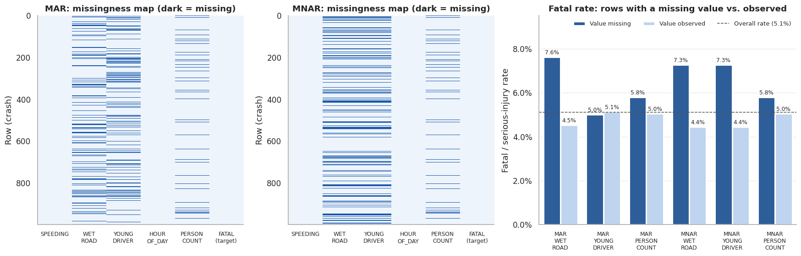{#fig-missingness}

Rows with `WET_ROAD` missing have a higher fatal/serious-injury rate in both files: 7.6% vs. 4.5% under
MAR and 7.3% vs. 4.4% under MNAR (Fisher's exact test [@fisher1922], p ≈ 0.10 and 0.09). Dropping
those rows will therefore remove severe crashes, even under MAR.
:::

::: {.content-visible when-format="revealjs"}
## Two kinds of missingness

:::: columns
::: {.column width="45%"}
- **MAR:** gaps depend only on what we *can* see. **MNAR:** gaps depend on the *hidden value itself*.
- MAR: scattered gaps → **38.5%** of rows incomplete.
- MNAR: `WET_ROAD` and `YOUNG_DRIVER` vanish **together** → 29.3% of rows incomplete.
- Rows missing `WET_ROAD` are more often severe (≈ 7.5% vs. 4.5%).
:::
::: {.column width="55%"}

:::
::::
:::

::: {.content-hidden when-format="revealjs"}
## A best-available truth {#sec-reference}

The MAR file, the MNAR file and the first 1,000 rows of `features.xls` agree on **every** cell observed
in more than one of them (0 disagreements out of 5,172–5,547 shared cells). Because each hides different
cells, combining them recovers the true value of most gaps. The remaining 44 `WET_ROAD` and 49
`YOUNG_DRIVER` cells are missing in all three files. We derive them from always-complete source fields,
using the data dictionary:

| Flag | Derivation rule | Basis | Agreement with known values |
|---|---|---|---|
| `WET_ROAD` | `ROAD_CONDITION` ∈ {08 Water, 09 Wet} | Learned from data; codes from dictionary | 956 / 956 (100%) |
| `YOUNG_DRIVER` | any of `DRIVER_COUNT_16YR`…`_20YR` > 0 | Dictionary definition ("at least 1 driver age 16–20") | 948 / 951 (99.7%) |

: Derivation rules for the last unrecoverable cells {#tbl-derive}

The three `YOUNG_DRIVER` conflicts (rows 623, 624, 913) are inconsistencies within the source data:
the flag is 1 while every 16–20 driver count is 0. The result is a complete 1,000-row **reference**.
About 99% of its cells are recorded values and the rest are rule-derived. Every "bias" below is
distance from this reference.

**Direct MNAR check.** With the hidden values known, we compare them with the observed ones. We
then test whether a cell's true value predicts that it is missing after controlling for the
always-observed variables (a logistic regression of the missingness indicator on the true value,
`SPEEDING`, `HOUR_OF_DAY` and the outcome).

| File | Variable | True mean (hidden) | Mean (observed) | p (raw) | p (conditional) |
|---|---|---|---|---|---|
| MAR | `WET_ROAD` | 0.152 | 0.143 | 0.73 | 0.77 |
| MAR | `YOUNG_DRIVER` | 0.160 | 0.180 | 0.54 | 0.50 |
| MNAR | `WET_ROAD` | **0.184** | 0.133 | 0.06 | **0.05** |
| MNAR | `YOUNG_DRIVER` | 0.145 | 0.185 | 0.17 | 0.17 |
| both | `PERSON_COUNT` | 2.68 | 2.34 | 0.06 | 0.29 |

: Hidden vs. observed values. Raw p from Fisher's exact test (flags) or Mann–Whitney [@mann1947] (count) {#tbl-hidden}

The MAR file behaves like MAR. In the MNAR file, wet roads were about 40% more common among hidden
cells, and the effect holds after conditioning (p ≈ 0.05). `YOUNG_DRIVER` points the expected way but
is not significant. The evidence supports the MNAR label but is borderline, not conclusive. Note also
that the `PERSON_COUNT` gaps are not completely random, but they are largely explained by observed
variables.
:::

::: {.content-visible when-format="revealjs"}
## Rebuilding the truth to measure bias

- The three files **never disagree** where they overlap, and each hides different cells → combining them
  recovers most gaps.
- The last 93 cells are derived from complete fields: `WET_ROAD` ← `ROAD_CONDITION` ∈ {08, 09} (**100%**
  agreement); `YOUNG_DRIVER` ← 16–20 driver counts (**99.7%**).
- **Direct MNAR check** (true hidden vs. observed values):

| File | Variable | Hidden | Observed | p (conditional) |
|---|---|---|---|---|
| MAR | `WET_ROAD` | 0.152 | 0.143 | 0.77 |
| MNAR | `WET_ROAD` | **0.184** | 0.133 | **0.05** |
| MNAR | `YOUNG_DRIVER` | 0.145 | 0.185 | 0.17 |

→ MNAR is supported, mainly by `WET_ROAD`, but the evidence is **borderline**.
:::

::: {.content-hidden when-format="revealjs"}
## Treatments and their effect on the data

Each file is treated three ways:

* **mean imputation:** replace each gap with the column mean;
* **median imputation:** replace each gap with the column median;
* **complete-case (CC) removal:** drop every row with any gap.

@fig-hist-mar and @fig-hist-mnar compare the original and treated distributions side by side, with the
reference marked by black diamonds. Two artifacts are immediately visible. Mean imputation creates values
that cannot occur (e.g. `WET_ROAD = 0.13`). Median imputation sets every missing yes/no value to "no",
because the median of a rare flag is 0.

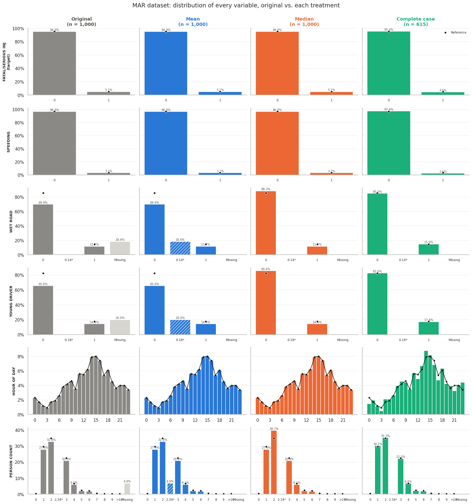{#fig-hist-mar}

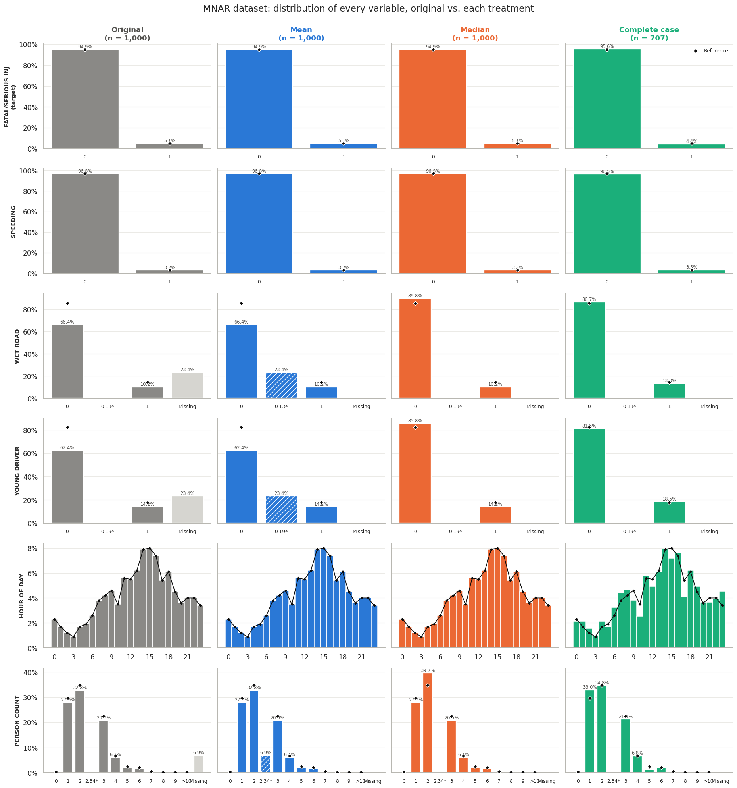{#fig-hist-mnar}

@fig-mean-bias summarizes the distortion of each variable's mean.

* **Mean imputation** reproduces the observed mean exactly. Under MAR that is nearly unbiased. Under
  MNAR it inherits the observed-data bias (wet roads −8%, young drivers +6%).
* **Median imputation** understates wet roads by 19% (MAR) and 30% (MNAR), and young drivers by 18–19%.
* **Complete-case removal** keeps 615 (MAR) or 707 (MNAR) rows. It lowers the fatal/serious rate from
  5.1% to 4.6% (MAR) and 4.4% (MNAR) because the removed rows were disproportionately severe. Under MAR
  it discards 23 of the 51 severe crashes.

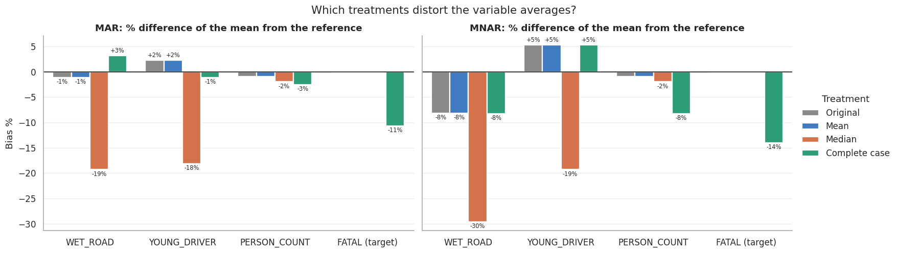{#fig-mean-bias}
:::

::: {.content-visible when-format="revealjs"}
## Side-by-side: original vs. treated (MNAR)

{height="600px"}

## Which treatments distort the data?

- **Median** turns every missing yes/no into "no": wet roads −19% (MAR), **−30%** (MNAR).
- **Complete case** drops severe crashes: fatal rate 5.1% → **4.4%** (MNAR).
- **Mean** is right under MAR but inherits the observed-data bias under MNAR.
:::

::: {.content-hidden when-format="revealjs"}
## Logistic regression on every dataset

We fit
$$
\operatorname{logit} P(\text{severe}) = \beta_0 + \beta_1\,\text{SPEEDING} + \beta_2\,\text{WET\_ROAD}
+ \beta_3\,\text{YOUNG\_DRIVER} + \beta_4\,\text{HOUR\_OF\_DAY} + \beta_5\,\text{PERSON\_COUNT}
$$
on each treated dataset and on the reference [@hosmer2013]. Because only 5.1% of crashes are severe, an
unweighted model predicts "not severe" for everyone: **94.9% accuracy and F1 = 0**. We therefore use
balanced class weights, which trade accuracy for the ability to find severe crashes. Performance is
estimated with stratified 5-fold cross-validation repeated 20 times. The original (untreated) files
cannot be fitted directly; standard software silently drops incomplete rows, which *is* complete-case analysis.

We run two evaluations. In the first, each model is scored on its own treated data. In the second, a
**fair head-to-head**, each model is trained on treated training rows (imputation statistics from those
rows only) and scored on the **true reference values** of the same held-out rows (@tbl-perf).

| Treatment | MAR F1 | MNAR F1 | MAR accuracy | MNAR accuracy | MAR AUC | MNAR AUC |
|---|---|---|---|---|---|---|
| Mean | 0.085 | 0.092 | 0.614 | 0.585 | 0.517 | 0.536 |
| Median | 0.088 | 0.095 | 0.618 | 0.586 | 0.518 | 0.540 |
| Complete case | 0.092 | 0.099 | 0.580 | 0.639 | 0.520 | 0.541 |
| Reference | 0.098 | 0.098 | 0.590 | 0.590 | 0.540 | 0.540 |

: Fair head-to-head: trained on treated data, tested on true values (means over 100 folds; fold-to-fold sd ≈ 0.034 F1, 0.07 accuracy) {#tbl-perf}

**Predictive differences are smaller than the noise.** F1 ranges from 0.085 to 0.099, against a
fold-to-fold standard deviation of about 0.034, and ROC AUC sits at 0.52–0.54, barely above chance. With
only `SPEEDING` statistically significant (odds ratio ≈ 4, p ≈ 0.007), the five predictors carry little
signal. When scored on its own data, the MNAR complete-case model looks best (accuracy 0.646, F1 0.102,
AUC 0.581). That is an illusion: it is tested only on the less severe rows that survived the MNAR filter.

**Bias shows up in the coefficients.** @fig-md-or compares each treatment's odds ratios with the
reference. @tbl-bias reports the root-mean-square error of the coefficients on a per-standard-deviation
scale, so all five predictors are comparable.

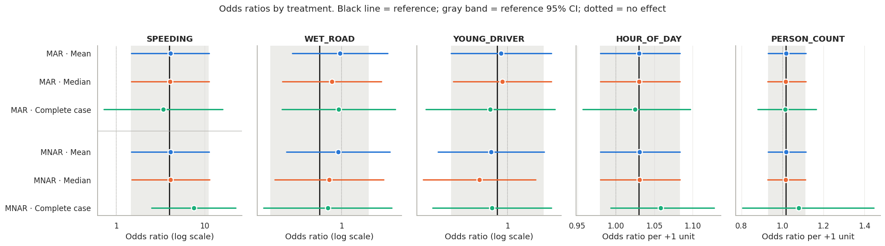{#fig-md-or}

| Treatment | MAR coef. RMSE | MNAR coef. RMSE | MAR CI width vs. ref. | MNAR CI width vs. ref. |
|---|---|---|---|---|
| Mean |  |  | 1.01× | 1.04× |
| Median |  |  | 1.02× | 1.07× |
| Complete case |  | **** | 1.40× | **1.64×** |

: Coefficient bias vs. the reference (lower is better) {#tbl-bias}

Under MNAR, complete-case removal nearly doubles the coefficient error and inflates the speeding odds
ratio from 4.0 to 7.5. It also widens confidence intervals by 40–64% because it discards data.
:::

::: {.content-visible when-format="revealjs"}
## Accuracy and F1 barely differ

- No weighting: **94.9% accuracy, F1 = 0** (the model predicts "not severe" for everyone). We use balanced class weights.
- Fair test: train on treated data, **test on true values** of the same held-out rows:

| Treatment | MAR F1 | MNAR F1 | MAR AUC | MNAR AUC |
|---|---|---|---|---|
| Mean | 0.085 | 0.092 | 0.517 | 0.536 |
| Median | 0.088 | 0.095 | 0.518 | 0.540 |
| Complete case | 0.092 | 0.099 | 0.520 | 0.541 |
| Reference | 0.098 | 0.098 | 0.540 | 0.540 |

- Differences are **smaller than fold-to-fold noise** (F1 sd ≈ 0.034). The predictors are weak (AUC ≈ 0.53).

## Bias shows up in the coefficients

{width="100%"}

:::: columns
::: {.column width="45%"}
| Treatment | MAR RMSE | MNAR RMSE |
|---|---|---|
| Mean | 0.062 | 0.058 |
| Median | 0.040 | 0.059 |
| **Complete case** | 0.064 | **0.110** |
:::
::: {.column width="55%"}
- Coefficient error vs. the reference (per-SD scale).
- MNAR complete case: speeding OR **7.5 vs. 4.0**; CIs **64% wider**.
:::
::::
:::

::: {.content-hidden when-format="revealjs"}
## Part I findings

1. **Complete-case removal is the most biased treatment under both mechanisms, and markedly so
   under MNAR.** The removed rows are systematically different (wetter roads, more severe crashes),
   so deleting them shifts the outcome rate, distorts coefficients and widens every interval.
2. **Mean imputation is the least biased simple method overall.** It preserves variable means
   (exactly, under MAR) and keeps coefficients close to the reference. It does create impossible
   fractional flag values and shrinks variance.
3. **Median imputation should not be used for binary predictors.** It silently recodes every gap as
   "no", the largest distortion of the predictor distributions. Its coefficient error is similar to
   mean imputation.
4. **Under MNAR, every simple treatment stays biased.** A method that uses only observed values cannot
   know that the hidden roads were wetter.
5. **Better than any imputation:** recover the values from source fields (@tbl-derive), or use multiple
   imputation with auxiliary variables and missingness indicators [@vanbuuren2011], plus a sensitivity
   analysis for MNAR.
:::

::: {.content-visible when-format="revealjs"}
## Part I take-aways

1. **Complete case = most biased**, especially under MNAR (drops severe crashes; ~2× coefficient error).
2. **Mean imputation = least biased** simple method (exact means under MAR).
3. **Median imputation distorts yes/no variables** (every gap becomes "no").
4. **Under MNAR, no simple method is unbiased.**
5. **Best fix:** recover values from source fields (`ROAD_CONDITION`, driver-age counts), or use multiple imputation.
:::

# Part II: What makes a rural crash severe?

::: {.content-hidden when-format="revealjs"}
## Cleaning and the rural lens {#sec-dedup}

Part II uses all 80 columns of `features.xls`. Three cleaning steps matter:

1. **Collapse duplicated crashes.** Consecutive rows that agree on every non-roadway column (at
   least 60 columns compared) are one crash. None of the merged crashes has a conflicting time of day,
   and 161 of them differ in `SPEED_LIMIT`/`LANE_COUNT`, as expected for multiple roads. Crash fields
   take the first non-missing value, and roadway fields take the maximum (the fastest road involved).
   This leaves ** crashes**, of which  are severe
   (). Without this step, copies of one crash would land in both training
   and test folds.
2. **Rebuild calculated flags.** `WET_ROAD`, `YOUNG_DRIVER`, `DRIVER_20YR`, `DRIVER_50_64YR` and
   `MULTIPLE_VEHICLE` are rebuilt from complete source fields (99.6–100% agreement with known values).
3. **Drop duplicate and undocumented columns** (`TIME_OF_DAY`, `ILLUMINATION`, `URBAN_RURAL`,
   `URBAN_AREA`). Remaining gaps are mean-imputed inside each training fold.

{#fig-dedup width="70%"}

**Rural lens.** Only  of  rural crashes were severe.
A common guideline asks for about ten outcome events per predictor [@peduzzi1996], so ten features on
rural crashes alone would be unstable. We therefore train on all crashes and apply the rural lens at
every step: the filter is run on rural crashes separately, rural evidence enters the final selection,
the model is evaluated on rural crashes alone, and conclusions are drawn for rural roads.
:::

::: {.content-visible when-format="revealjs"}
## Cleaning and the rural lens

- **Deduplicate:**  rows → ** crashes**
  ( severe, ). This prevents copies of one crash from
  appearing in both training and test folds.
- **Rebuild flags** from complete source fields (99.6–100% agreement).
- **Rural lens:** only ** of ** rural crashes were severe, too few
  for a 10-feature rural-only model (≈ 10 events per feature needed). So we **train on all crashes**,
  then filter, evaluate and interpret **for rural roads**.
:::

::: {.content-hidden when-format="revealjs"}
## Feature selection

**Step 1: first principles.** Crash severity is the energy that reaches a human body, relative to
what that body can tolerate. Each column is assigned to a mechanism, or rejected:

| Mechanism | Reasoning | Examples |
|---|---|---|
| Energy / speed | Kinetic energy grows with speed² | `SPEEDING`, `SPEED_LIMIT` |
| Unprotected road user | No crash structure, belts or airbags | `MOTORCYCLE`, `PEDESTRIAN` |
| Crash geometry | Head-on and side impacts: high closing speed, little crush space | `REAR_END`, `HEAD_ON`, `NON_COLLISION` |
| Impairment & behavior | Changes speeds, reactions and crash types | `IMPAIRED_DRIVER`, `AGGRESSIVE_DRIVING` |
| Frailty / inexperience | Older bodies tolerate less force | `DRIVER_75PLUS`, `YOUNG_DRIVER` |
| Environment | Visibility, speed and friction | `ILLUMINATION_DARK`, `WET_ROAD` |
| Road setting; vehicle mix | Speeds, conflicts, mass mismatch | `STATE_ROAD`, `HEAVY_TRUCK_COUNT` |

: First-principles screen (73 candidates kept) {#tbl-mech}

Rejected columns: administrative and calendar fields (county, month, day of week), undocumented or
duplicate codes, and `AUTOMOBILE_COUNT` (a proxy for vehicle mix with no mechanism of its own). `RURAL`
is the analysis lens, not a predictor, because it is constant on rural roads. No remaining column
records the outcome, so there is no leakage.

**Step 2: a simple filter.** Each candidate is tested on its own, on all crashes and on rural crashes.
For flags we report the risk ratio
$$
\text{RR} = \frac{P(\text{severe} \mid \text{flag} = 1)}{P(\text{severe} \mid \text{flag} = 0)}
$$
with Fisher's exact test [@fisher1922]; numeric features use the Mann–Whitney test [@mann1947]. A
feature passes if it is exposed in at least 15 crashes and has p < 0.20 in either group. The threshold
is loose because this is screening, and with 36 events a strict cut-off would discard real effects.

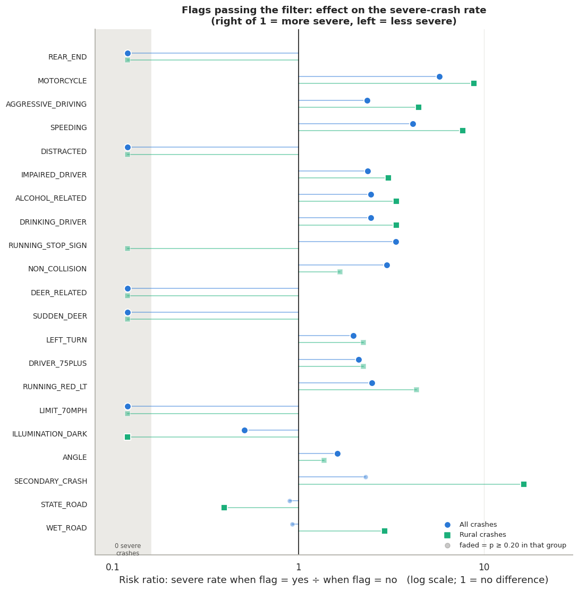{#fig-filter}

**Step 3: redundancy and the final pick.** Several passing flags carry the same information.
`ALCOHOL_RELATED` is identical to `DRINKING_DRIVER`, and both sit inside `IMPAIRED_DRIVER`.
`RUNNING_STOP_SIGN` and `RUNNING_RED_LT` are entirely contained in `AGGRESSIVE_DRIVING`. `SUDDEN_DEER`
≈ `DEER_RELATED`. We keep the umbrella flag in each case. `SPEEDING` is also contained in
`AGGRESSIVE_DRIVING`, but it is kept for its distinct energy mechanism and its strong signal. Combining
filter rank, first-principles strength and rural evidence gives the final ten (@tbl-final).
`ILLUMINATION_DARK` was chosen over `LEFT_TURN`, the next by overall p-value, because of its stronger
rural signal and its core mechanism.

| Feature | Mechanism | RR (all) | p (all) | RR (rural) | p (rural) |
|---|---|---|---|---|---|
| `MOTORCYCLE` | Unprotected road user | 5.73 | 0.001 | 8.81 | 0.024 |
| `SPEEDING` | Energy / speed | 4.12 | 0.018 | 7.64 | 0.032 |
| `AGGRESSIVE_DRIVING` | Impairment & behavior | 2.35 | 0.016 | 4.45 | 0.057 |
| `IMPAIRED_DRIVER` | Impairment & behavior | 2.36 | 0.053 | 3.06 | 0.165 |
| `DRIVER_75PLUS` | Frailty | 2.10 | 0.117 | 2.24 | 0.260 |
| `NON_COLLISION` | Crash geometry | 3.00 | 0.084 | 1.67 | 0.483 |
| `REAR_END` | Crash geometry | 0 severe of 127 | 0.001 | 0 of 19 | 0.611 |
| `DISTRACTED` | Impairment & behavior | 0 severe of 70 | 0.042 | 0 of 9 | 1.000 |
| `DEER_RELATED` | Crash geometry | 0 severe of 49 | 0.100 | 0 of 29 | 0.215 |
| `ILLUMINATION_DARK` | Environment | 0.51 | 0.165 | 0 of 46 | 0.069 |

: The ten selected features and their filter statistics {#tbl-final}
:::

::: {.content-visible when-format="revealjs"}
## Feature selection: first principles + a simple filter

:::: columns
::: {.column width="42%"}
1. **First principles:** keep columns with an injury mechanism (energy, unprotected user, crash
   geometry, impairment, frailty, environment). **73 candidates.**
2. **Filter:** Fisher's exact test and risk ratio per flag, on **all** and **rural** crashes;
   pass if p < 0.20 and ≥ 15 exposed.
3. **Redundancy:** keep the umbrella flag (`IMPAIRED_DRIVER` ⊃ drinking/alcohol;
   `AGGRESSIVE_DRIVING` ⊃ stop-sign/red-light).
:::
::: {.column width="58%"}

:::
::::

## The proposed ten features

| Raises severity | RR (all / rural) | Lowers severity | Severe crashes |
|---|---|---|---|
| `MOTORCYCLE` | 5.7 / 8.8 | `REAR_END` | 0 of 127 |
| `SPEEDING` | 4.1 / 7.6 | `DISTRACTED` | 0 of 70 |
| `AGGRESSIVE_DRIVING` | 2.4 / 4.5 | `DEER_RELATED` | 0 of 49 |
| `IMPAIRED_DRIVER` | 2.4 / 3.1 | `ILLUMINATION_DARK` | 5 of 163 |
| `DRIVER_75PLUS` | 2.1 / 2.2 | | |
| `NON_COLLISION` | 3.0 / 1.7 | | |
:::

::: {.content-hidden when-format="revealjs"}
## Multicollinearity

The largest pairwise correlation among the ten features is 0.29 (`ILLUMINATION_DARK` with
`IMPAIRED_DRIVER`; impaired driving is mostly at night). Every variance inflation factor,
$\text{VIF}_j = 1/(1 - R_j^2)$, is below 1.25, far from the usual warning levels of 5 and 10. By
contrast, the top ten by p-value alone, without the redundancy step, contains identical columns with
infinite VIF (@fig-vif).

::: {layout-ncol=2}
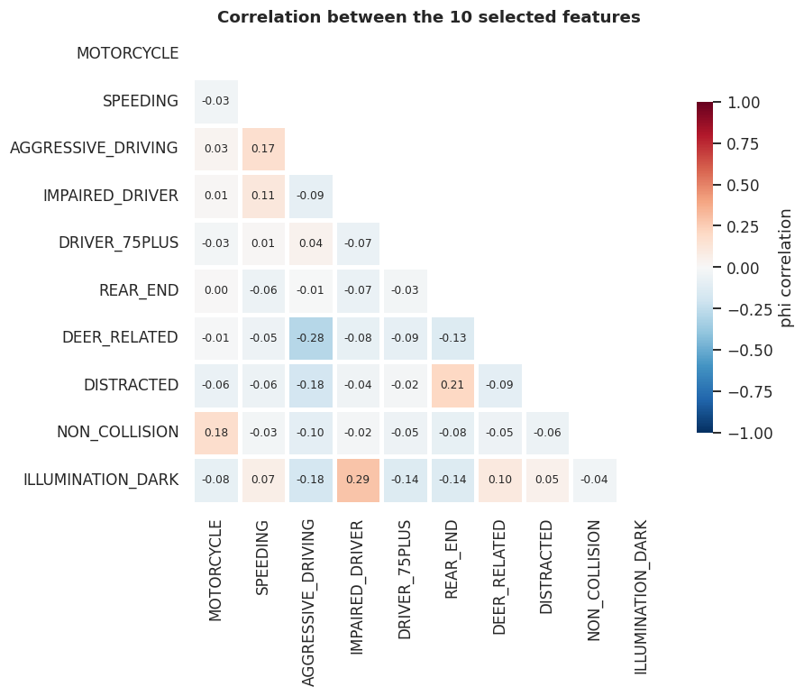{#fig-corr}

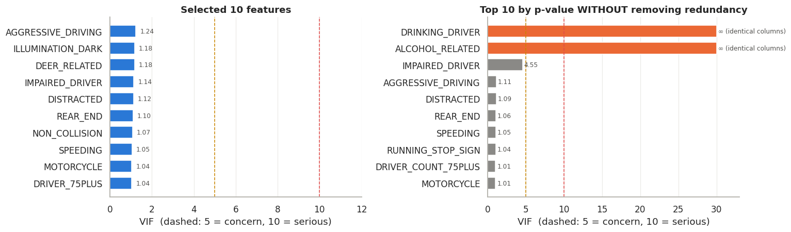{#fig-vif}
:::
:::

::: {.content-visible when-format="revealjs"}
## No multicollinearity

- All VIFs **< 1.25**; the largest correlation is 0.29 (darkness × impairment).
- Without the redundancy step: identical columns (`ALCOHOL_RELATED` = `DRINKING_DRIVER`), **VIF = ∞**.
:::

::: {.content-hidden when-format="revealjs"}
## Feature analysis

@fig-feature-rates shows the severe-crash rate with and without each factor, for all crashes and for
rural crashes. On rural roads, half of motorcycle crashes and 40% of speeding crashes were severe.

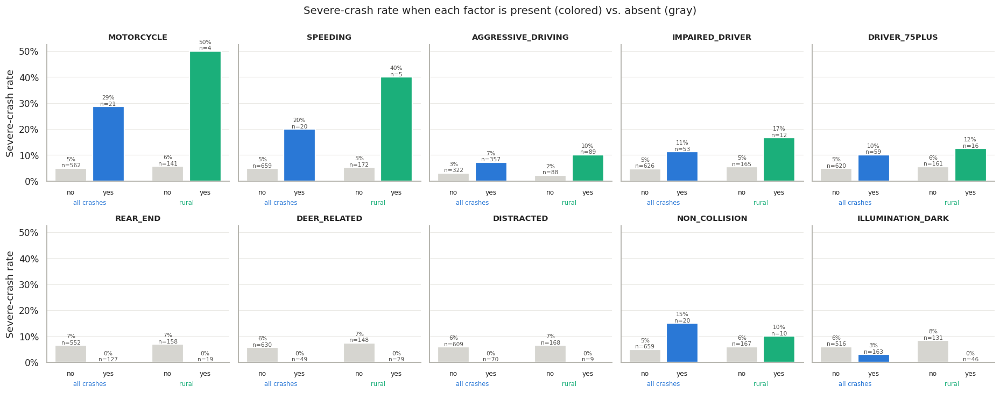{#fig-feature-rates}

**How rural crashes differ.** Deer strikes are four times as common in rural crashes (16% vs. 4%),
and none of the 49 was severe. Non-collision events are 2.8× as common. Rear-end and distraction
crashes are about half as common, which helps explain the higher rural severe rate (6.2% vs. 5.0%).
The main risk factors (aggressive driving, impairment, speeding, drivers aged 75+) occur about as often
on rural roads as elsewhere.

**Why darkness looks protective.** First principles say darkness should *raise* severity, yet dark
crashes were severe less often (3.1% vs. 6.0%). The crash mix explains it: motorcycle crashes happen
almost entirely in daylight (4.5% of daylight crashes vs. 0.7% of dark ones), and dark crashes are
twice as often deer strikes. Darkness is a useful *predictor* here, but the association is not causal.
:::

::: {.content-visible when-format="revealjs"}
## Feature analysis

- Rural: **50%** of motorcycle crashes and **40%** of speeding crashes were severe.
- Deer strikes: **4×** more common on rural roads, **never** severe. Darkness looks protective only
  because of the crash mix (few motorcycles at night, more deer).
:::

::: {.content-hidden when-format="revealjs"}
## The final model

**Model.** Logistic regression on the ten features, with mean imputation and standardization learned
inside each training fold, balanced class weights and a mild L2 penalty. The penalty is needed because
three features have zero severe crashes, which would push unpenalized coefficients to −∞ (complete
separation; @firth1993 discusses penalized alternatives).

**Threshold.** The probability cut-off is tuned to maximize F1, where
$F_1 = 2\,\text{precision}\cdot\text{recall}/(\text{precision}+\text{recall})$. It is chosen by an
inner cross-validation within each training fold, so the test fold never influences it (median
threshold 0.75).

**Evaluation.** Stratified 5-fold cross-validation repeated 20 times (100 test folds), reported for all
crashes and for rural crashes alone.

| Scope | Accuracy | Precision | Recall | F1 | ROC AUC |
|---|---|---|---|---|---|
| All crashes |  |  |  |  |  |
| Rural crashes |  |  |  |  |  |
| *Always "not severe"* | ** | *0* | *0* | *0* | *0.500* |

: Final model, cross-validated means over 100 test folds {#tbl-final-perf}

Accuracy is the wrong yardstick for a 5% outcome [@saito2015]. The trivial model scores 94.7% and finds
nothing. Our model gives up some accuracy to catch about 28% of severe crashes overall and 41% on
rural roads. Roughly one in four of its "severe" flags is correct, 4–5× the base rate. It ranks crashes
well, especially rural ones (AUC 0.84). Rural metrics are noisy: each rural test fold holds only about
two severe crashes (F1 sd ≈ 0.25).

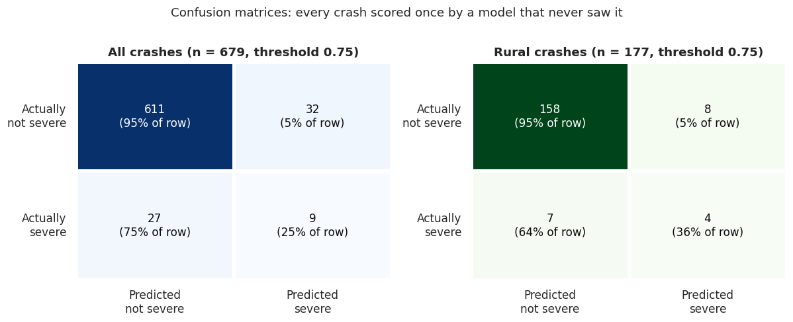{#fig-confusion}

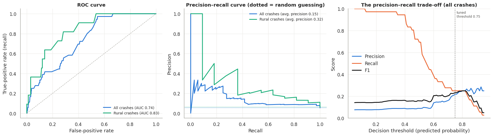{#fig-curves}

**Is this the best ten?** Under the same folds, the selected ten outperform every alternative tested:

| Feature set | F1 (all) | F1 (rural) | AUC (all) | AUC (rural) |
|---|---|---|---|---|
| All 73 candidates | 0.111 | 0.143 | 0.645 | 0.751 |
| Top 10 by p-value only | 0.159 | 0.208 | 0.709 | 0.780 |
| Selected ten, darkness → left turn | 0.201 | 0.239 | 0.741 | 0.789 |
| **Selected ten** | **0.225** | **0.304** | **0.761** | **0.841** |

: Selected model vs. alternatives {#tbl-alts}

The selection used the full dataset, so the selected model's scores are slightly optimistic for
new data.
:::

::: {.content-visible when-format="revealjs"}
## Final model performance

| Scope | Accuracy | Precision | Recall | F1 | ROC AUC |
|---|---|---|---|---|---|
| All crashes |  |  |  |  |  |
| Rural crashes |  |  |  |  |  |
| *Always "not severe"* | ** | *0* | *0* | *0* | *0.5* |

- L2-penalized logistic regression, balanced weights, **F1-tuned threshold chosen inside each training fold**.
- Trades accuracy for finding **28%** (all) / **41%** (rural) of severe crashes; 1 in 4 flags correct.
- Beats all 73 features (AUC 0.65) and the top 10 by p-value alone (AUC 0.71).

## Where the model succeeds and misses

:::

::: {.content-hidden when-format="revealjs"}
## Which factors matter most on rural roads?

For interpretation, the ten-feature model is refitted on all crashes without class weights, keeping the
mild penalty. 95% intervals come from 1,000 bootstrap resamples (@fig-or). For the three zero-severe
flags, the *direction* is certain (no resample puts them above 1), but their *size* is set mostly by
the penalty.

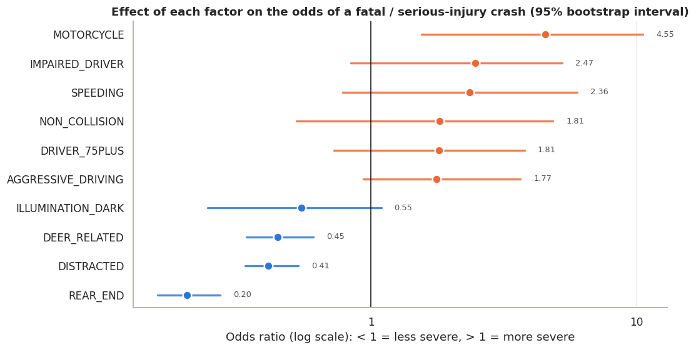{#fig-or}

How much a factor contributes to rural severe crashes depends on its odds ratio **and** on how often it
occurs. The population attributable fraction [@miettinen1974] among the severe rural cases is
$$
\text{PAF} = p_c \,\frac{\text{OR} - 1}{\text{OR}},
$$
where $p_c$ is the share of severe rural crashes with the factor.

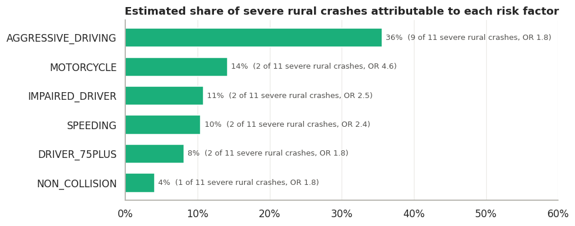{#fig-paf}

1. **Aggressive driving contributes the most.** It appears in about half of rural crashes and in 9 of
   the 11 severe ones, accounting for roughly a third of them (PAF ≈ 36%), despite a moderate odds
   ratio of 1.8.
2. **Motorcycles are the most dangerous single factor** (OR ≈ 4.6, 95% CI 1.6–10.6), the only factor
   whose interval clearly excludes no effect.
3. **Impairment and speeding** each raise the odds about 2.4× and account for about 10% of severe
   rural crashes each.
4. **Drivers aged 75+ and non-collision events** each raise the odds about 1.8×. Non-collision events
   are 2.8× more common on rural roads.
5. **Low-risk rural crashes** are deer strikes (common, never severe), and rear-end and distraction
   crashes (mostly non-rural).
:::

::: {.content-visible when-format="revealjs"}
## What drives severe rural crashes

:::: columns
::: {.column width="55%"}

:::
::: {.column width="45%"}

:::
::::

- **Aggressive driving** contributes the most (9 of 11 severe rural crashes; PAF ≈ 36%).
- **Motorcycles** are the most dangerous factor (OR ≈ **4.6**); impairment and speeding ≈ **2.4×**.
:::

# Discussion and limitations

::: {.content-hidden when-format="revealjs"}
* **Few severe crashes.** There are 36 in total and 11 on rural roads. Only `MOTORCYCLE` has an interval
  that clearly excludes no effect. `AGGRESSIVE_DRIVING` and `IMPAIRED_DRIVER` are borderline.
* **Duplicates also affect Part I.** The MAR and MNAR files are row-for-row copies of the first 1,000
  rows of `features.xls`, so they contain the same duplicated crashes. Their cross-validated scores are
  likely inflated, because copies of one crash can fall in both training and test folds. The comparison
  *between* treatments is still fair, since every treatment shares the problem.
* **Association, not causation**, especially for darkness and the zero-severe flags.
* **Missing variables.** The extract lacks seat-belt use, curvature, undivided two-lane head-on risk and
  distance to trauma care, all central to rural severity.
* **Slight optimism.** The features were selected on the full dataset.
* **Origin of the missingness.** In `features.xls`, about 16 unrelated columns each have 200–260 gaps,
  while most have none. This pattern suggests the missingness was introduced for the exercise. Real
  PennDOT flags such as `WET_ROAD` are calculated fields, not hand-entered.
:::

::: {.content-visible when-format="revealjs"}
## Limitations

- **Few events:** 36 severe crashes, 11 rural → wide intervals; only motorcycle clearly ≠ 1.
- **Duplicates affect Part I too:** the MAR/MNAR files share the repeated crashes, so absolute scores are
  inflated (the comparison between treatments is still fair).
- **Association, not causation** (darkness, zero-severe flags).
- **Missing variables:** seat belts, curves, two-lane head-on risk, distance to trauma care.
- Features selected on the full data → slightly optimistic scores.
:::

# Conclusion

::: {.content-hidden when-format="revealjs"}
How missing data are handled changes the model. Complete-case removal, the default in most software,
was the most biased choice and was worst when data were missing not at random. Simple imputation was
less biased, and recovering values from source fields was better still. For rural crash severity, a
small, mechanism-driven feature set outperformed both a purely statistical selection and the full
feature set. It points to aggressive driving, motorcycles, impairment and speeding as the levers that
matter most on rural roads. Confirming these findings requires multi-year PennDOT data, with thousands
of severe rural crashes, and the missing safety variables listed above.
:::

::: {.content-visible when-format="revealjs"}
## Take-aways

1. **Complete-case removal is the most biased** missing-data treatment, worst under MNAR. Prefer mean
   imputation over median for yes/no fields, and **recover values from source fields** when possible.
2. **Accuracy misleads** for a 5% outcome: always report precision, recall, F1 and AUC.
3. **Ten mechanism-driven features** beat the full set and a purely statistical pick (rural AUC **0.84**).
4. **On rural roads:** aggressive driving contributes the most severe crashes; motorcycles are the most
   dangerous; impairment and speeding each ≈ 2.4×.
5. **Next:** multi-year data, seat-belt and road-geometry variables, and a rural-only model.
:::

# References {.unnumbered}

::: {#refs}
:::
